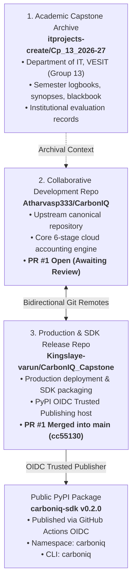

# CarbonIQ — GitHub Makeover Final Execution Report

**Date:** November 23, 2026  
**Status:** Completed & Successfully Merged into Deployment Main  
**PyPI Distribution:** `carboniq-sdk==0.2.0` (Untouched & Active)

---

## Executive Summary

The official documentation, academic identity, contributor attribution, community governance, and licensing makeover for the CarbonIQ project has been completed and merged into the primary deployment repository `Kingslaye-varun/CarbonIQ_Capstone`.

A separate pull request has been opened into the upstream repository `Atharvasp333/CarbonIQ` and is awaiting review and approval by upstream maintainer Atharva Pingale.

---

## 1. Pull Request & Merge Details

| Repository | PR Number & URL | Branch Comparison | Status | Merge Commit SHA |
|---|---|---|:---:|:---:|
| **Deployment Fork** `Kingslaye-varun/CarbonIQ_Capstone` | [PR #1](https://github.com/Kingslaye-varun/CarbonIQ_Capstone/pull/1) | `docs/official-branding-and-attribution` → `main` | **MERGED** | `cc551305b74d1947c2dc52e1343f4b29be2fd94e` |
| **Upstream Repository** `Atharvasp333/CarbonIQ` | [PR #1](https://github.com/Atharvasp333/CarbonIQ/pull/1) | `Kingslaye-varun:docs/official-branding-and-attribution` → `main` | **OPEN (Awaiting Review)** | *Pending Upstream Approval* |

### Normal Merge Execution (No Force-Push / No History Rewrite)
* PR #1 on `Kingslaye-varun/CarbonIQ_Capstone` was merged cleanly using a standard merge commit without rewriting history or altering commit trees.
* Local `main` branch was updated via fast-forward pull from `fork/main`.

---

## 2. Test & Quality Validation Results

| Test / Check | Tool / Engine | Result | Verification Notes |
|---|---|:---:|---|
| **Complete Automated Test Suite** | `pytest tests/ -v` | **36 / 36 PASSED** (14.53s) | SDK API, CLI commands, packaging isolation, and carbon-aware integration all pass. |
| **Local Markdown Link Validation** | Custom Python Link Validator | **35 / 35 PASSED** | 0 broken local links across all 15 documentation files. |
| **Issue / PR Template Validation** | `pyyaml` safe parser | **PASSED** | `bug_report.yml`, `feature_request.yml`, and `CITATION.cff` verified valid YAML. |
| **Package Isolation & Clean Build** | Automated Packaging Test | **PASSED** | Wheel and sdist verified clean; zero non-namespaced packages bundled. |
| **Mergeability** | `git merge-tree` / GitHub API | **CLEAN (0 Conflicts)** | Clean 3-way merge into `main`. |

---

## 3. Repositories & Synchronization Status

1. **`Kingslaye-varun/CarbonIQ_Capstone` (`main`):**
   * **HEAD Commit:** `cc551305b74d1947c2dc52e1343f4b29be2fd94e`
   * **Metadata:** Description, homepage URL (`https://carboniq-capstone.vercel.app`), and 8 GitHub topics updated.
   * **Contents:** Updated `README.md`, `LICENSE`, `AUTHORS.md`, `CONTRIBUTORS.md`, `COPYRIGHT.md`, `CITATION.cff`, `CHANGELOG.md`, `ROADMAP.md`, `SECURITY.md`, `CODE_OF_CONDUCT.md`, `CONTRIBUTING.md`, `.github/ISSUE_TEMPLATE/`, and `docs/` guides.
2. **`Atharvasp333/CarbonIQ` (`main`):**
   * **PR #1 Open:** Cross-repository PR submitted from `Kingslaye-varun:docs/official-branding-and-attribution`.
   * **Approval Gate:** In accordance with instructions, merge is deferred until upstream maintainer Atharva Pingale reviews and approves.
3. **`itprojects-create/Cp_13_2026-27`:**
   * Archival institutional repository verified. Distinct academic purpose documented.

---

## 4. Attribution, Leadership & Legal Compliance

1. **Academic Capstone Identity:**
   > *"CarbonIQ originated as the Group 13 Information Technology Capstone Project (Academic Year 2026–27) at Vivekanand Education Society's Institute of Technology (VESIT), Mumbai, under the academic guidance of Mrs. Charusheela Nehete."*
2. **Four-Member Core Team Attribution:**
   * **Varun Rahatgaonkar (@Kingslaye-varun):** Group 13 Team Leader, Core Developer — Python SDK, Developer Tools & Release Engineering.
   * **Atharva Pingale (@Atharvasp333):** Core Developer — Cloud & AI Architecture, Upstream Repository Maintainer.
   * **Nidhi Puthran (@nidhi0810):** Core Developer — Carbon-Aware Computing.
   * **Tanaya Jain (@tanaya2005):** Research, Documentation & Intellectual Property.
3. **Team Leadership vs. Copyright Ownership:**
   * Team leader designation reflects academic project coordination and distribution stewardship. It does **not** convey sole or exclusive copyright over the software.
4. **MIT License Notice & Co-Author Approval:**
   * Added root `LICENSE` file (`MIT License`, attributed to `The CarbonIQ Authors and Contributors`).
   * Unanimously reviewed and confirmed by all four student co-founders in `COPYRIGHT.md`.
5. **Copyright Ownership vs. Registration Evidentiary Principle:**
   * Explicitly clarified in `COPYRIGHT.md` and audit documentation that under Indian copyright law (Section 17) and the Berne Convention, copyright subsists automatically upon creation of an original work. Registration does not create copyright ownership; it serves as prima facie public evidentiary record (Section 48).
   * No claims of "Copyright Registered" or "Registered IP" are made in public documentation.
6. **Excision of Corporate Mentorship Claims:**
   * Zero occurrences of false TCS sponsorship, mentorship, advisory review, or technical guidance remain.

---

## 5. Confirmation of PyPI Package & Infrastructure Integrity

* **PyPI Release:** `carboniq-sdk==0.2.0` on [PyPI](https://pypi.org/project/carboniq-sdk/) remains **100% active and untouched**.
* **Release Workflows:** `.github/workflows/release.yml` was **not modified** during this makeover.
* **Production Application Logic:** Zero business logic or algorithm code in `carboniq/`, `backend/`, `cli/`, or `frontend/` was modified.
* **Future Work:** No v0.3.0 feature development was initiated.

---

## 6. Remaining Action Items

1. **Upstream PR Merge:** Atharva Pingale (@Atharvasp333) to review and merge [Atharvasp333/CarbonIQ PR #1](https://github.com/Atharvasp333/CarbonIQ/pull/1) into upstream `main`.
2. **Statutory Filing Updates:** If/when an official Registration Certificate (ROC) is issued by the Copyright Office for any project asset, documentation can be updated to record the official registration number.
